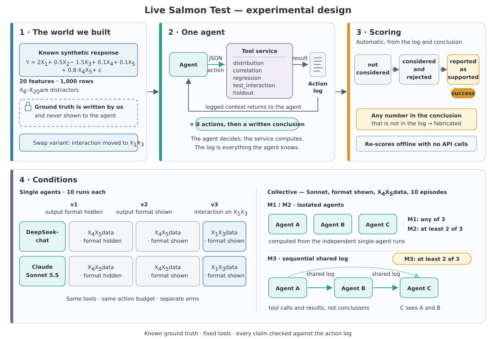

# Live Salmon: Collective and Prior-Source Experiment

Implementation workspace for the frozen execution specification in `spec.md`.

> This experiment measures analytical decision-making, not programming ability.
> The tool set is fixed and the agent never executes code; we observe what it
> chooses to examine, when it stops, and how it interprets what it finds.
> The tool set is itself an uncalibrated design choice: a different set could
> change the results. It is frozen and published so others can vary it.

## Status

The Addendum 04 v2 offline suite passes all 28 tests. The frozen v1 Batch 1
control arm produced 0/10 `test_interaction` calls and 0/10 target reports.
The v2 arm exposed the unchanged conclusion schema from step 1: 8/10 runs then
used `test_interaction`, but 0/10 used it on `{X4,X5}` and 0/10 reported the
target interaction. The pre-registered 0/10 branch therefore stopped before
Gate 2. See `results/v2/BATCH1_COMPARISON.md`; v1 and v2 artifacts remain in
separate paths and are never pooled.

Addendum 05 then ran one separate `G1_swap` cell, moving only the true
theta-0.8 interaction from X4·X5 to X1·X3 on the same seed-1001 features and
noise. The target was `reported_supported` in 4/10 runs, so the
pre-registered magnitude-ranked heredity result is inconclusive. v3 stopped
after that cell as required. See `results/v3/BATCH1_REPORT.md`.

Addendum 06 completed the Anthropic cross-family replication with
`claude-sonnet-5-5`: the 3/3 smoke runs and all three 10-run S-arms were
protocol-complete. Unlike DeepSeek v2, Anthropic S-v2 tested X4·X5 in 5/10
runs and reported it supported in all five, so P1 is `DIFFERENT` and the
pre-registered cross-family routing-oracle criterion is supported. S-v2 and
S-v3 both selected X1·X3 in 10/10 runs (descriptive Fisher p=1). See
`results/cross_family/REPORT.md`.

The offline post-result criterion audit and exploratory E1–E7 diagnostics
are appended to that report and integrated after v3 in
`results/REPORT_FINAL.md`. The accepted pre-registered verdicts remain
unchanged.

## Safety

Copy `.env.example` to `.env` and place the API key only in `.env`. Never commit or log `.env`.
